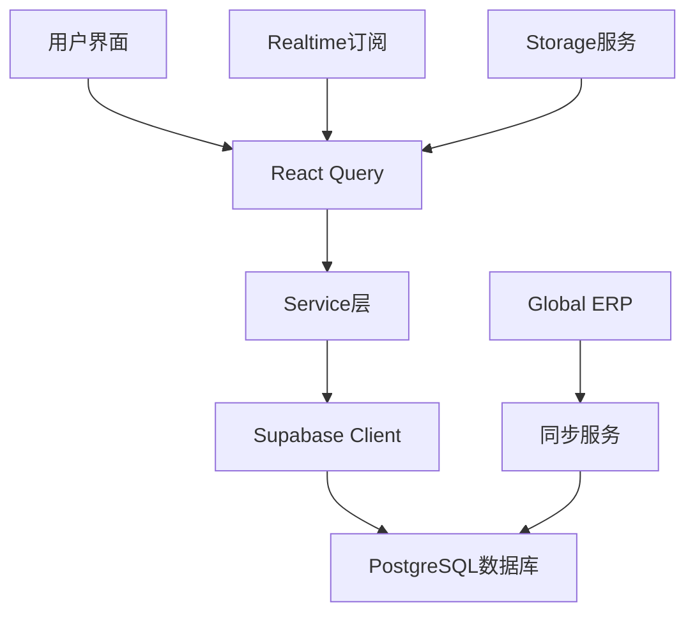

# 嘉哥优选项目需求、技术栈和功能清单

## 🎯 项目定位

**平台名称**: 嘉哥优选  
**核心定位**: 综合采购引导网站  
**服务对象**: B2B买家、多品类供应商、平台管理员  
**业务模式**: 撮合交易 + 供应链服务

---

## 🛠️ 技术栈架构

### 前端技术栈
```typescript
// 核心框架
- React 18 + TypeScript
- Vite (构建工具)
- React Router v6 (路由管理)

// UI组件系统
- Tailwind CSS (样式框架)
- shadcn-ui (基于Radix UI的组件库)
- Lucide React (图标库)
- Sonner + 内置toast (通知系统)

// 状态管理
- TanStack React Query (服务端状态)
- Zustand (全局状态，轻量使用)
- React Context (认证状态)

// 表单处理
- React Hook Form (表单管理)
- Zod (数据验证)

// 工具库
- date-fns (日期处理)
- clsx (样式合并)
```

### 后端技术栈
```sql
-- 数据库
- Supabase (PostgreSQL + 实时功能)
- Row Level Security (RLS数据权限)

-- 认证授权
- Supabase Auth (用户认证)
- JWT Token (会话管理)

-- 存储服务
- Supabase Storage (文件存储)
- Cloudflare Stream (视频处理)

-- 实时功能
- Supabase Realtime (数据订阅)
- WebSocket (实时通信)
```

### 第三方集成
```typescript
// 数据同步
- Global ERP Service (商品数据源)
- 产品快照同步系统

// 开发工具
- ESLint (代码规范)
- TypeScript (类型检查)
- Git (版本控制)
```

---

## 📱 应用架构

### 目录结构
```
src/
├── components/          # React组件
│   ├── ui/             # shadcn-ui基础组件
│   ├── auth/           # 认证相关组件
│   ├── admin/          # 管理员组件
│   ├── product/        # 产品相关组件
│   ├── quotations/     # 报价相关组件
│   ├── layout/         # 布局组件
│   └── ...
├── pages/              # 页面组件
├── hooks/              # 自定义hooks
├── services/           # API服务层
├── integrations/       # 第三方集成
└── lib/               # 工具函数
```

### 数据流架构


---

## 🚀 核心功能模块

### 1. 用户认证与权限系统
#### 功能特性
- **用户注册/登录**: 邮箱注册、密码找回
- **角色管理**: 买家、供应商、管理员三角色
- **权限控制**: 基于RLS的数据安全隔离
- **用户档案**: 基础信息、联系方式、认证状态

#### 技术实现
```typescript
// 认证状态管理
const useAuth = () => {
  const [user, setUser] = useState<User | null>(null);
  const [role, setRole] = useState<UserRole | null>(null);
  
  // Supabase Auth集成
  useEffect(() => {
    supabase.auth.onAuthStateChange((event, session) => {
      setUser(session?.user || null);
    });
  }, []);
};

// RLS策略示例
CREATE POLICY "Users can view their own data" 
ON profiles FOR SELECT 
USING (auth.uid() = id);
```

### 2. 多品类商品管理系统
#### 功能特性
- **商品分类**: 3级分类体系，支持多品类
- **商品展示**: 列表、网格、详情多种视图
- **搜索筛选**: 分类、价格、供应商等多维筛选
- **批量操作**: 导入、编辑、上下架

#### 支持的商品品类
```typescript
enum ProductCategory {
  FOOD = 'food',           // 食材类
  EQUIPMENT = 'equipment', // 设备类  
  FURNITURE = 'furniture', // 家具类
  DECORATION = 'decoration', // 装饰类
  PACKAGING = 'packaging'   // 包装类
}
```

#### 数据同步机制
```typescript
// Global ERP同步
const syncProducts = async () => {
  const erpProducts = await globalErpService.fetchProducts();
  
  const localProducts = erpProducts.map(product => ({
    id: product.id,
    source_type: 'global_erp',
    source_id: product.id,
    // 字段映射...
  }));
  
  await supabase.from('products').upsert(localProducts);
};
```

### 3. 购物车与货单系统
#### 功能特性
- **多品类购物车**: 支持不同品类商品混合
- **货单生成**: 从购物车一键生成结构化货单
- **货单分享**: 生成分享链接供供应商查看
- **状态管理**: draft → shared → expired状态流转

#### 数据结构
```typescript
interface ProductList {
  id: string;
  user_id: string;
  name: string;
  description?: string;
  status: 'draft' | 'shared' | 'expired';
  share_code?: string;
  total_amount: number;
  items: ProductListItem[];
}

interface ProductListItem {
  product_id: string;
  quantity: number;
  unit_price: number;
  custom_price?: number;
}
```

### 4. 报价询价系统
#### 功能特性
- **询价发起**: 基于货单创建询价请求
- **供应商报价**: 多供应商竞价机制
- **报价对比**: 价格、服务、交期等多维对比
- **沟通记录**: 实时聊天和历史记录

#### 实现流程
```typescript
// 询价流程
const createQuotation = async (productListId: string) => {
  // 1. 基于货单创建报价请求
  const quotation = await quotationService.create({
    product_list_id: productListId,
    status: 'draft'
  });
  
  // 2. 通知相关供应商
  await notifySuppliers(quotation.id);
  
  return quotation;
};
```

### 5. 订单管理系统
#### 功能特性
- **订单创建**: 基于确认报价生成订单
- **订单跟踪**: 实时状态更新和物流跟踪
- **多供应商订单**: 自动拆分不同供应商子订单
- **财务管理**: 应付款、发票管理

#### 订单状态流
```typescript
enum OrderStatus {
  PENDING = 'pending',
  CONFIRMED = 'confirmed', 
  SHIPPED = 'shipped',
  DELIVERED = 'delivered',
  COMPLETED = 'completed',
  CANCELLED = 'cancelled'
}
```

### 6. 供应商管理系统
#### 功能特性
- **供应商档案**: 基础信息、资质认证
- **产品管理**: 供应商商品上传和管理
- **订单处理**: 接单、发货、结算
- **评价系统**: 买家评价和信用积累

#### 供应商分类
```typescript
interface SupplierProfile {
  id: string;
  business_type: 'food' | 'equipment' | 'furniture' | 'mixed';
  service_areas: string[];
  certifications: string[];
  delivery_capability: DeliveryInfo;
}
```

### 7. 实时通信系统
#### 功能特性
- **消息通知**: 订单、报价、系统通知
- **实时聊天**: 买家供应商直接沟通
- **数据同步**: 实时数据更新推送

#### 技术实现
```typescript
// Supabase Realtime集成
const useRealtimeUpdates = (table: string) => {
  useEffect(() => {
    const subscription = supabase
      .channel('public-changes')
      .on('postgres_changes', 
        { event: '*', schema: 'public', table },
        (payload) => {
          // 处理实时更新
        }
      )
      .subscribe();
    
    return () => subscription.unsubscribe();
  }, [table]);
};
```

### 8. 管理后台系统
#### 功能特性
- **用户管理**: 用户列表、角色分配、权限控制
- **商品管理**: 商品审核、批量导入、分类管理
- **订单监控**: 订单统计、异常处理
- **数据分析**: 销售报表、用户行为分析

#### 权限矩阵
| 功能模块 | 管理员 | 供应商 | 买家 |
|----------|--------|--------|------|
| 用户管理 | ✅ | ❌ | ❌ |
| 商品管理 | ✅ | ✅ | ❌ |
| 订单查看 | ✅ | ✅ | ✅ |
| 报价管理 | ✅ | ✅ | ✅ |

---

## 🔧 开发与部署

### 开发环境配置
```bash
# 安装依赖
npm install

# 开发环境启动
npm run dev  # localhost:8080

# 代码检查
npm run lint

# 生产构建
npm run build
```

### 环境变量配置
```env
# Supabase配置
VITE_SUPABASE_URL=https://xxx.supabase.co
VITE_SUPABASE_ANON_KEY=xxx

# Cloudflare Stream配置
VITE_CLOUDFLARE_ACCOUNT_ID=xxx
VITE_CLOUDFLARE_API_TOKEN=xxx
```

### 数据库迁移
```sql
-- 位于 /supabase/migrations/
-- 自动版本管理和增量更新
-- 支持回滚和数据验证
```

---

## 📊 性能指标

### 技术性能
- **页面加载时间**: < 3秒
- **API响应时间**: < 500ms
- **数据库查询**: < 100ms
- **实时更新延迟**: < 1秒

### 业务指标
- **用户转化率**: 目标 > 15%
- **供应商响应率**: 目标 > 80%
- **订单完成率**: 目标 > 95%
- **平台活跃度**: 目标日活 > 1000

---

## 🔮 功能扩展规划

### 短期规划（1-3个月）
- **移动端适配**: 响应式设计优化
- **支付集成**: 在线支付和财务管理
- **物流跟踪**: 第三方物流API集成

### 中期规划（3-6个月）
- **AI推荐**: 智能商品推荐算法
- **数据分析**: 商业智能报表系统
- **API开放**: 第三方系统集成接口

### 长期规划（6-12个月）
- **供应链金融**: 信贷和保险服务
- **国际化**: 多语言和货币支持
- **生态建设**: 合作伙伴开放平台

---

**项目当前状态**: MVP已完成60%，核心功能基本就绪  
**技术债务**: 低，代码质量良好，架构清晰  
**扩展性**: 高，支持水平扩展和功能模块化