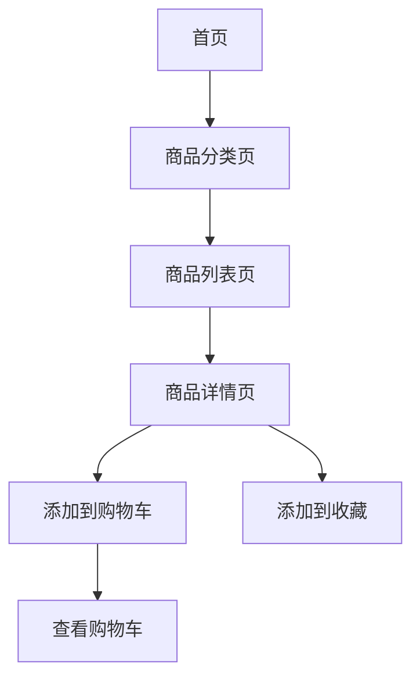

# 嘉哥优选用户体验：从MVP到成交的完整步骤

## 🎯 用户旅程概览

**平台目标**: 将访客转化为成交买家  
**核心流程**: 发现需求 → 浏览商品 → 生成货单 → 询价比价 → 确认成交  
**平均转化周期**: 3-7天  
**目标转化率**: 15%+

---

## 👥 用户角色定义

### 买家用户
- **目标用户**: 餐厅老板、采购经理、装修负责人
- **核心需求**: 一站式采购、优质供应商、合理价格
- **使用场景**: 新店开业、设备更新、定期采购

### 供应商用户  
- **目标用户**: 食材商、设备商、家具商
- **核心需求**: 获得订单、展示产品、管理客户
- **使用场景**: 接收询价、报价竞争、订单履约

---

## 🚀 MVP功能优先级

### Phase 1: 核心MVP（已完成60%）
✅ **用户注册登录**  
✅ **商品浏览展示**  
✅ **购物车功能**  
✅ **货单生成**  
⏳ **货单分享**（开发中）  
⏳ **询价系统**（开发中）

### Phase 2: 增强功能（计划中）
🔄 **报价对比**  
🔄 **订单管理**  
🔄 **支付集成**  
🔄 **物流跟踪**

---

## 📱 用户体验设计原则

### 设计理念
- **简单直观**: 3次点击完成核心操作
- **响应快速**: 页面加载 < 3秒
- **移动友好**: 手机端操作体验优良
- **数据安全**: 用户数据完全保护

### 界面特色
- **现代化UI**: shadcn-ui组件系统
- **一致性**: 统一的视觉语言
- **可访问性**: 支持键盘导航和屏幕阅读器

---

## 🛍️ 完整用户旅程详解

### Step 1: 用户发现与注册 🔍
#### 用户行为
1. **搜索引擎发现** → 访问嘉哥优选首页
2. **浏览产品分类** → 了解平台定位
3. **查看示例商品** → 评估平台价值
4. **决定注册** → 点击注册按钮

#### 体验优化
```typescript
// 首页设计重点
- 清晰的平台价值主张
- 热门商品分类展示
- 成功案例和用户评价
- 简化的注册流程（3个字段）
```

#### 转化指标
- **首页停留时间** > 30秒
- **注册转化率** > 8%
- **注册完成率** > 95%

---

### Step 2: 商品发现与浏览 🛒
#### 用户行为
1. **登录平台** → 进入商品浏览页面
2. **选择分类** → 食材/设备/家具等
3. **使用筛选** → 价格、品牌、供应商
4. **查看详情** → 深入了解商品信息
5. **添加收藏** → 保存感兴趣的商品

#### 页面流程图


#### 关键功能点
```typescript
// 商品浏览体验优化
interface ProductBrowsing {
  // 多维筛选
  filters: {
    category: string[];
    priceRange: [number, number];
    supplier: string[];
    inStock: boolean;
  };
  
  // 智能推荐
  recommendations: Product[];
  
  // 快速操作
  quickActions: {
    addToCart: () => void;
    addToWishlist: () => void;
    viewDetails: () => void;
  };
}
```

#### 转化指标
- **商品页面浏览深度** > 3页
- **商品详情查看率** > 40%
- **购物车添加率** > 25%

---

### Step 3: 购物车与货单生成 📋
#### 用户行为
1. **查看购物车** → 确认已选商品
2. **调整数量** → 修改采购数量
3. **生成货单** → 创建结构化采购清单
4. **填写需求** → 补充特殊要求和说明

#### 购物车体验设计
```typescript
// 购物车功能特性
interface ShoppingCart {
  // 商品分组显示
  groupBySupplier: boolean;
  groupByCategory: boolean;
  
  // 批量操作
  selectAll: () => void;
  removeSelected: () => void;
  
  // 价格计算
  subtotal: number;
  estimatedShipping: number;
  totalAmount: number;
  
  // 快速操作
  saveForLater: () => void;
  createProductList: () => void;
}
```

#### 货单生成流程
```typescript
// 货单创建步骤
const createProductList = async (cartItems: CartItem[]) => {
  // 1. 用户输入货单信息
  const listInfo = await showProductListDialog();
  
  // 2. 生成货单
  const productList = await productListService.createFromCart(
    cartItems, 
    listInfo.name
  );
  
  // 3. 清空购物车
  await clearCart();
  
  // 4. 跳转到货单页面
  navigate(`/orders/${productList.id}`);
};
```

#### 转化指标
- **购物车完成率** > 60%
- **货单生成率** > 80%
- **货单平均商品数** > 5个

---

### Step 4: 货单分享与询价 💬
#### 用户行为
1. **完善货单信息** → 添加描述和特殊要求
2. **生成分享链接** → 创建供应商可访问的链接
3. **选择供应商** → 手动选择或平台推荐
4. **发送询价** → 通过微信、邮件等方式分享

#### 分享功能设计
```typescript
// 货单分享机制
interface ProductListSharing {
  shareCode: string;
  shareUrl: string;
  accessCount: number;
  
  // 分享方式
  generateQRCode: () => string;
  copyToClipboard: () => void;
  sendByEmail: (emails: string[]) => void;
  
  // 访问统计
  viewHistory: ShareAccess[];
  responseRate: number;
}
```

#### 供应商视角体验
```typescript
// 供应商查看货单
const SupplierViewProductList = () => {
  return (
    <div className="supplier-view">
      {/* 买家信息 */}
      <BuyerInfo buyer={productList.buyer} />
      
      {/* 货单详情 */}
      <ProductListDetails items={productList.items} />
      
      {/* 快速报价按钮 */}
      <QuickQuoteButton 
        onQuote={() => createQuotation(productList.id)}
      />
      
      {/* 联系买家 */}
      <ContactBuyerButton buyer={productList.buyer} />
    </div>
  );
};
```

#### 转化指标
- **货单分享率** > 90%
- **供应商访问率** > 70%
- **询价响应率** > 50%

---

### Step 5: 报价对比与选择 🔍
#### 用户行为
1. **接收报价通知** → 邮件/短信/平台通知
2. **查看报价详情** → 价格、交期、服务条件
3. **对比多个报价** → 使用对比工具分析
4. **与供应商沟通** → 澄清疑问和谈判
5. **选择最优方案** → 确认最终供应商

#### 报价对比界面
```typescript
// 报价对比功能
interface QuotationComparison {
  quotations: Quotation[];
  
  // 对比维度
  compareBy: {
    totalPrice: boolean;
    unitPrice: boolean;
    deliveryTime: boolean;
    paymentTerms: boolean;
    supplierRating: boolean;
  };
  
  // 决策辅助
  recommendedQuotation: Quotation;
  riskAssessment: RiskLevel;
  
  // 沟通记录
  conversations: Conversation[];
}
```

#### 沟通功能设计
```typescript
// 买家供应商实时沟通
const QuotationChat = ({ quotationId }: { quotationId: string }) => {
  const [messages, setMessages] = useState<Message[]>([]);
  
  // 实时消息订阅
  useRealtimeSubscription('quotation_conversations', {
    filter: `quotation_id=eq.${quotationId}`,
    callback: (payload) => {
      setMessages(prev => [...prev, payload.new]);
    }
  });
  
  return (
    <ChatInterface 
      messages={messages}
      onSendMessage={sendMessage}
      participants={[buyer, supplier]}
    />
  );
};
```

#### 转化指标
- **报价查看率** > 95%
- **供应商沟通率** > 60%
- **报价接受率** > 30%

---

### Step 6: 订单确认与成交 ✅
#### 用户行为
1. **确认最终报价** → 点击接受报价
2. **创建正式订单** → 系统自动生成订单
3. **确认订单详情** → 核对商品、价格、交期
4. **选择付款方式** → 在线支付或线下转账
5. **完成下单** → 订单进入履约阶段

#### 订单确认流程
```typescript
// 订单创建流程
const confirmOrder = async (quotationId: string) => {
  // 1. 验证报价有效性
  const quotation = await validateQuotation(quotationId);
  
  // 2. 创建订单
  const order = await orderService.createFromQuotation(quotation);
  
  // 3. 发送确认通知
  await notificationService.sendOrderConfirmation(order);
  
  // 4. 跳转支付页面
  navigate(`/orders/${order.id}/payment`);
};
```

#### 支付体验设计
```typescript
// 支付选项
interface PaymentOptions {
  methods: {
    alipay: boolean;
    wechatPay: boolean;
    bankTransfer: boolean;
    creditTerms: boolean; // 信用账期
  };
  
  // 分期付款
  installmentOptions: {
    deposit: number; // 定金比例
    finalPayment: number; // 尾款
    paymentSchedule: Date[]; // 付款计划
  };
}
```

#### 转化指标
- **订单确认率** > 85%
- **支付完成率** > 95%
- **订单平均金额** > ¥10,000

---

## 📊 关键转化漏斗

### 整体转化数据
```
访问用户      → 注册用户     → 浏览商品     → 生成货单
100%         → 8%          → 60%         → 25%
(1000人)     → (80人)      → (48人)      → (12人)

生成货单      → 分享询价     → 收到报价     → 确认成交
25%          → 22%         → 15%         → 3%
(12人)       → (11人)      → (7人)       → (1.5人)
```

### 关键优化点
1. **首页价值传达** → 提升注册转化率
2. **商品发现效率** → 提升浏览深度
3. **购物车体验** → 提升货单生成率
4. **分享便利性** → 提升询价响应率
5. **报价对比工具** → 提升成交转化率

---

## 🔧 体验优化策略

### 技术优化
```typescript
// 性能优化
- 图片懒加载和压缩
- 代码分割和按需加载
- CDN加速和缓存策略
- 数据库查询优化

// 用户体验优化
- 加载状态指示
- 错误边界处理
- 无网络状态提示
- 数据本地缓存
```

### 产品优化
- **个性化推荐**: 基于用户行为的智能推荐
- **快捷操作**: 一键重复下单、收藏夹快速添加
- **进度提示**: 清晰的流程进度指示
- **帮助指导**: 新手引导和操作提示

### 运营优化
- **客服支持**: 在线客服和FAQ系统
- **活动促销**: 新用户优惠和批量采购折扣
- **内容营销**: 采购指南和行业资讯
- **社群建设**: 用户群和行业交流

---

## 🎯 成功指标定义

### 用户增长指标
- **月活跃用户**: 目标1000+
- **用户留存率**: 次日70%，7日40%，30日20%
- **用户推荐率**: NPS > 50

### 业务转化指标
- **整体转化率**: 访客到成交 > 1.5%
- **客单价**: 平均订单金额 > ¥10,000
- **复购率**: 30天内复购 > 25%

### 平台效率指标
- **响应速度**: 供应商24小时内响应率 > 80%
- **履约质量**: 订单按时完成率 > 95%
- **用户满意度**: 综合评分 > 4.5/5.0

---

**MVP完成度**: 60% → 目标年底达到80%  
**用户体验评分**: 当前4.2/5.0 → 目标4.5/5.0  
**转化效率**: 当前1.2% → 目标1.5%+