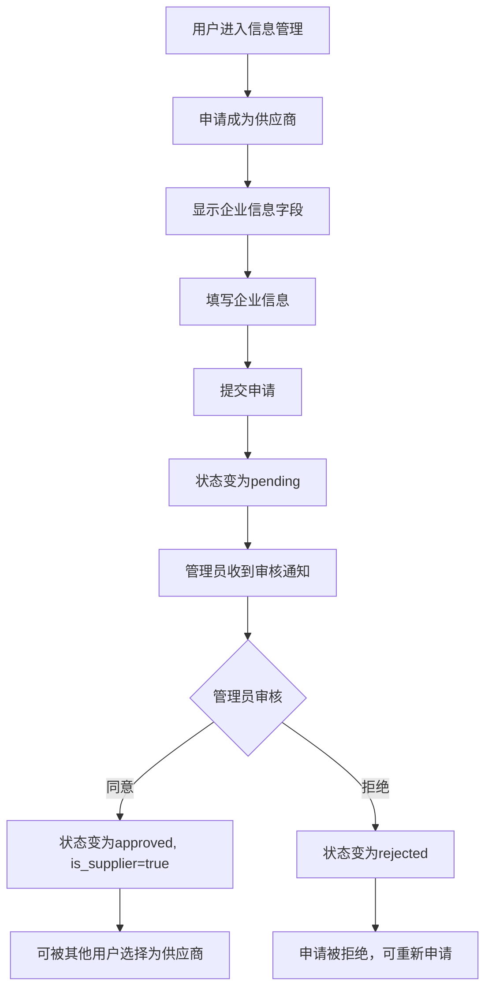
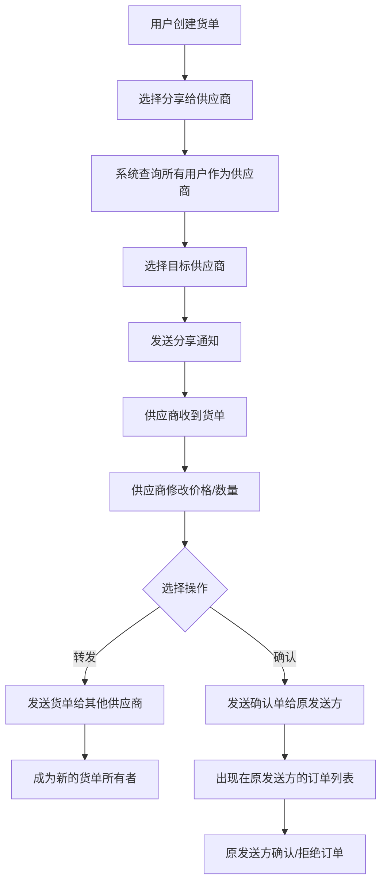
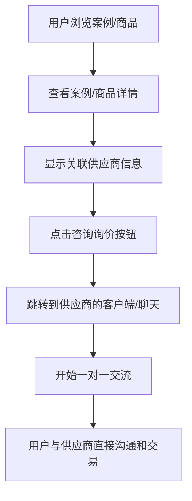
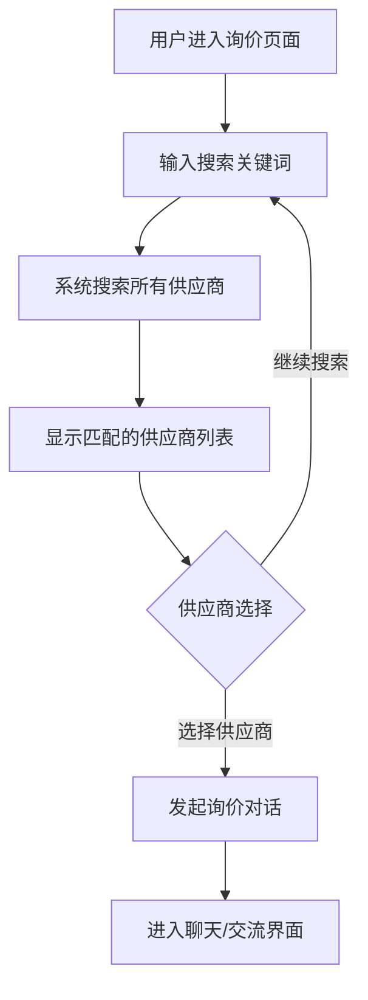
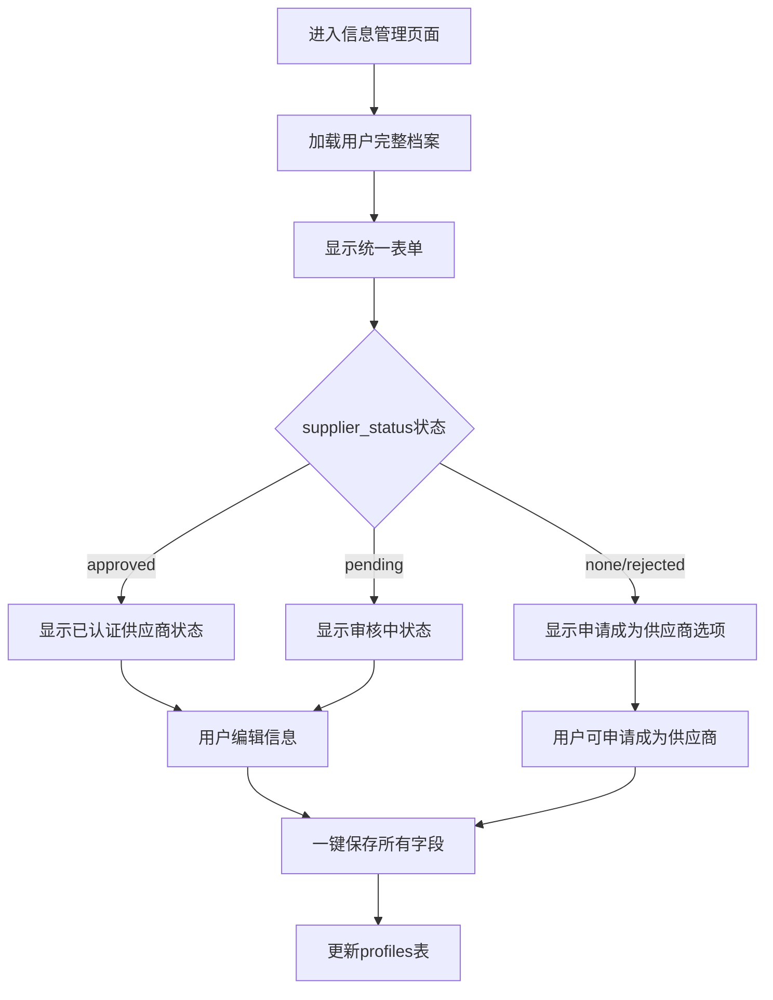

# 供应商系统重构设计文档

## 项目概述

本文档描述了贾哥食品中心平台的用户交互系统重构设计，实现了用户到用户的灵活货单分享模式，任何用户都可以接收、修改和处理货单，支持转发和确认两种处理方式。

## 设计背景

### 原有系统问题
- 复杂的供应商认证和验证流程
- 独立的供应商信息管理系统
- 用户和供应商身份割裂
- 繁琐的企业信息管理界面

### 用户需求
- 统一的用户体验：搜索、分享、咨询功能中，用户和供应商概念统一为"供应商"
- 开放的货单分享：不是认证供应商也可以被其他用户选择和分享货单
- 灵活的货单处理：接收用户可以修改价格和数量
- 双重处理选项：支持转发给其他用户或确认给原发送方
- 简化的订单确认流程：确认单直接进入发送方的订单列表
- 供应商申请审核机制：用户申请成为供应商需要管理员审核同意
- 统一的交互界面：案例和商品中点击咨询直接跳转到用户客户端

## 核心设计理念

> **统一供应商概念** - 在系统的搜索、分享、咨询等功能中，所有用户都被视为"供应商"，不区分是否经过认证。任何用户都可以被选择、分享货单，参与商业活动。认证供应商身份只是额外的信任标识。

## 系统架构重构

### 1. 数据库架构简化

#### 用户档案表 (profiles) 增强
```sql
-- 新增供应商相关字段
ALTER TABLE profiles ADD COLUMN is_supplier BOOLEAN DEFAULT FALSE;
ALTER TABLE profiles ADD COLUMN supplier_status TEXT DEFAULT 'none' CHECK (supplier_status IN ('none', 'pending', 'approved', 'rejected'));
ALTER TABLE profiles ADD COLUMN supplier_applied_at TIMESTAMPTZ;
ALTER TABLE profiles ADD COLUMN supplier_approved_at TIMESTAMPTZ;
ALTER TABLE profiles ADD COLUMN supplier_approved_by UUID REFERENCES profiles(id);
ALTER TABLE profiles ADD COLUMN company_name TEXT;
ALTER TABLE profiles ADD COLUMN company_description TEXT;
ALTER TABLE profiles ADD COLUMN business_license TEXT;
ALTER TABLE profiles ADD COLUMN company_address TEXT;
ALTER TABLE profiles ADD COLUMN company_phone TEXT;
ALTER TABLE profiles ADD COLUMN company_email TEXT;
```

#### 货单处理表 (order_list_responses) 新建
```sql
CREATE TABLE order_list_responses (
    id UUID PRIMARY KEY DEFAULT gen_random_uuid(),
    original_order_list_id UUID NOT NULL REFERENCES product_lists(id),
    shared_by UUID NOT NULL REFERENCES profiles(id),
    received_by UUID NOT NULL REFERENCES profiles(id),
    modified_items JSONB, -- 修改后的商品价格和数量
    original_total_amount DECIMAL(10,2),
    modified_total_amount DECIMAL(10,2),
    message TEXT,
    response_type TEXT NOT NULL CHECK (response_type IN ('forward', 'confirm')),
    status TEXT DEFAULT 'pending' CHECK (status IN ('pending', 'accepted', 'rejected', 'expired')),
    -- 如果是转发，创建新货单的ID
    forwarded_order_list_id UUID REFERENCES product_lists(id),
    created_at TIMESTAMPTZ DEFAULT NOW(),
    updated_at TIMESTAMPTZ DEFAULT NOW(),
    expires_at TIMESTAMPTZ
);
```

#### 货单分享记录表 (order_list_shares) 更新
```sql
-- 更新现有表以支持用户到用户分享
ALTER TABLE order_list_shares 
ADD COLUMN IF NOT EXISTS response_id UUID REFERENCES order_list_responses(id),
ADD COLUMN IF NOT EXISTS shared_to_type TEXT DEFAULT 'user' CHECK (shared_to_type IN ('user', 'supplier'));
```

### 2. 用户界面统一

#### 信息管理页面重构
- **原有设计**：分离的个人信息和企业信息标签页
- **新设计**：统一的表单界面，包含：
  - 基本个人信息（昵称、头像、联系方式等）
  - 供应商开关按钮
  - 条件显示的企业信息字段

#### 关键特性
- **渐进式信息收集**：只有启用供应商功能时才显示企业信息
- **可选企业信息**：企业信息完全可选，支持个人供应商
- **一键保存**：所有信息统一保存，避免多次操作

### 3. 供应商选择机制

#### 供应商搜索和选择
```typescript
// 查询所有用户作为潜在供应商，不限制认证状态
const getAvailableSuppliers = async (searchQuery?: string) => {
  let query = supabase
    .from('profiles')
    .select('id, nickname, avatar_url, company_name, is_supplier, supplier_status, ...')
    .neq('id', currentUser.id); // 排除自己
  
  if (searchQuery) {
    query = query.or(`nickname.ilike.%${searchQuery}%,company_name.ilike.%${searchQuery}%`);
  }
  
  return query.order('updated_at', { ascending: false });
};
```

#### 供应商显示逻辑
- 优先显示企业名称，fallback到昵称
- 所有用户都显示为"供应商"
- 认证供应商显示特殊认证标识
- 任何用户都可以被选择和接收货单

## 功能流程设计

### 1. 用户申请成为供应商流程



### 2. 货单分享和处理流程



### 3. 案例和商品中的供应商交互流程



### 4. 询价搜索流程



### 5. 信息管理统一流程



## 功能模块划分

### 核心功能模块

#### 1. 用户管理模块
- **用户档案管理**：个人信息和企业信息统一管理
- **供应商申请**：用户申请成为认证供应商
- **供应商审核**：管理员审核供应商申请

#### 2. 货单管理模块
- **货单创建**：用户创建和编辑货单
- **货单分享**：选择供应商分享货单
- **货单修改**：接收方修改价格和数量

#### 3. 交互通信模块
- **供应商搜索**：搜索和选择供应商
- **咨询交流**：案例/商品页面的咨询功能
- **询价对话**：用户与供应商的实时沟通

#### 4. 订单处理模块
- **货单转发**：修改后转发给其他供应商
- **订单确认**：生成确认单到发送方订单列表
- **订单管理**：订单状态跟踪和处理

### 功能间交互流程

#### 交互场景1：案例/商品咨询流程
```
案例/商品页面 → 供应商信息展示 → 咨询按钮 → 跳转供应商客户端 → 交流对话
```

#### 交互场景2：询价搜索流程
```
询价页面 → 供应商搜索 → 供应商列表 → 选择供应商 → 发起对话 → 交流界面
```

#### 交互场景3：货单分享处理流程
```
货单创建 → 供应商选择 → 货单分享 → 供应商接收 → 价格修改 → 转发/确认选择
├─ 转发：供应商选择 → 新货单创建 → 继续流转
└─ 确认：确认单生成 → 订单列表 → 订单处理
```

#### 交互场景4：供应商认证流程
```
用户申请 → 信息填写 → 申请提交 → 管理员审核 → 状态更新 → 认证标识显示
```

## 技术实现要点

### 1. 前端组件重构

#### ProfileManagementPage 统一表单
```typescript
interface PersonalInfo {
  // 基本信息
  nickname: string;
  avatar_url?: string;
  phone?: string;
  address?: string;
  bio?: string;
  
  // 供应商信息
  is_supplier: boolean;
  supplier_status: 'none' | 'pending' | 'approved' | 'rejected';
  supplier_applied_at?: string;
  supplier_approved_at?: string;
  company_name?: string;
  company_description?: string;
  business_license?: string;
  company_address?: string;
  company_phone?: string;
  company_email?: string;
}
```

#### 供应商状态条件渲染
```typescript
// 供应商申请状态显示
{personalInfo.supplier_status === 'approved' && (
  <div className="p-4 border rounded-lg bg-green-50">
    <h5 className="font-medium text-green-800">已认证供应商</h5>
    <p className="text-sm text-green-600">您已通过供应商认证</p>
  </div>
)}

{personalInfo.supplier_status === 'pending' && (
  <div className="p-4 border rounded-lg bg-yellow-50">
    <h5 className="font-medium text-yellow-800">申请审核中</h5>
    <p className="text-sm text-yellow-600">您的供应商申请正在等待管理员审核</p>
  </div>
)}

{(personalInfo.supplier_status === 'none' || personalInfo.supplier_status === 'rejected') && (
  <div className="space-y-4">
    <Button onClick={applySupplier}>申请成为供应商</Button>
    {/* 申请表单 */}
  </div>
)}

// 企业信息（供应商申请时或已认证时显示）
{(personalInfo.supplier_status !== 'none') && (
  <div className="space-y-4 p-4 border rounded-lg bg-muted/20">
    <h5 className="font-medium">企业信息</h5>
    {/* 企业信息字段 */}
  </div>
)}
```

### 2. 服务层简化

#### orderListService 重构
- 支持用户到用户的货单分享（不限制供应商身份）
- 实现货单转发和确认功能
- 统一的用户信息接口

#### 核心服务方法
```typescript
// 获取可分享的供应商列表（所有用户作为供应商）
async getAvailableSuppliers(searchQuery?: string): Promise<Supplier[]>

// 处理接收到的货单
async processReceivedOrderList(
  orderListId: string,
  modifications: ItemModification[],
  responseType: 'forward' | 'confirm',
  targetSupplierId?: string, // 转发时需要
  message?: string
): Promise<void>

// 创建确认单
async createConfirmationOrder(
  responseId: string,
  originalOrderListId: string,
  modifications: ItemModification[]
): Promise<Order>

// 供应商申请相关服务
async applyForSupplier(
  companyInfo: CompanyInfo,
  businessLicense: string
): Promise<void>

// 管理员审核供应商申请
async reviewSupplierApplication(
  userId: string,
  approved: boolean,
  adminId: string,
  reason?: string
): Promise<void>

// 获取待审核的供应商申请列表
async getPendingSupplierApplications(): Promise<SupplierApplication[]>

// 搜索所有供应商（用于询价和咨询）
async searchAllSuppliers(searchQuery: string): Promise<Supplier[]>

// 货单转发功能
async forwardOrderListToSupplier(
  originalOrderListId: string,
  modifications: ItemModification[],
  targetSupplierId: string,
  message?: string
): Promise<string> // 返回新货单ID

// 跳转到供应商客户端
async navigateToSupplierClient(
  supplierId: string,
  context: 'consultation' | 'inquiry'
): Promise<void>
```

#### 数据权限控制
```sql
-- RLS策略确保数据安全
CREATE POLICY "Users can create responses" ON order_list_responses
    FOR INSERT WITH CHECK (received_by = auth.uid());

CREATE POLICY "Users can view their responses" ON order_list_responses
    FOR SELECT USING (
        received_by = auth.uid() OR 
        shared_by = auth.uid()
    );

-- 供应商申请相关权限
CREATE POLICY "Users can apply for supplier" ON profiles
    FOR UPDATE USING (id = auth.uid())
    WITH CHECK (
        id = auth.uid() AND 
        (supplier_status = 'none' OR supplier_status = 'rejected')
    );

-- 管理员可以审核供应商申请
CREATE POLICY "Admins can review supplier applications" ON profiles
    FOR UPDATE USING (
        EXISTS (
            SELECT 1 FROM user_roles 
            WHERE user_id = auth.uid() AND role = 'admin'
        )
    );
```

### 3. 数据迁移策略

#### 渐进式迁移
1. 添加新字段到现有表
2. 保持向后兼容
3. 逐步移除旧的复杂结构
4. 数据完整性检查

## 用户体验优化

### 1. 用户体验优化
- **供应商申请流程**：清晰的申请状态显示和审核反馈
- **统一用户交互**：案例和商品中的"供应商"就是普通用户，点击直接跳转
- **全用户搜索**：询价时可以搜索所有用户，不限制身份
- **透明的身份展示**：供应商身份只是一个可选的认证标识

### 2. 提升交互效率
- **直接用户交互**：案例/商品中点击咨询直接跳转到用户客户端
- **全平台搜索**：询价功能搜索所有用户，扩大选择范围
- **简化货单处理**：接收用户可直接修改并选择转发或确认
- **快速身份识别**：认证供应商显示特殊标识，但不影响基本交互

### 3. 保持系统开放性
- **平等用户体验**：所有用户都可以参与货单分享和处理
- **可选供应商认证**：供应商身份是增值服务，不是必需条件
- **灵活的交易模式**：支持用户间的多种交互方式

## 性能优化

### 1. 数据库优化
```sql
-- 供应商查询索引
CREATE INDEX idx_profiles_is_supplier ON profiles(is_supplier) WHERE is_supplier = TRUE;

-- 报价查询索引
CREATE INDEX idx_order_list_quotations_order_list_id ON order_list_quotations(order_list_id);
CREATE INDEX idx_order_list_quotations_quoted_by ON order_list_quotations(quoted_by);
```

### 2. 查询优化
- 使用视图预聚合供应商信息
- 条件查询减少不必要的数据传输
- 缓存常用的供应商列表

## 安全考虑

### 1. 数据权限
- RLS策略保护敏感信息
- 用户只能修改自己的档案
- 报价权限验证供应商身份

### 2. 输入验证
- 前端表单验证
- 后端数据格式检查
- XSS和注入攻击防护

## 测试策略

### 1. 功能测试

#### 用户管理模块测试
- [ ] 用户申请成为供应商功能
- [ ] 管理员审核供应商申请功能
- [ ] 供应商状态显示（none/pending/approved/rejected）
- [ ] 企业信息条件显示/隐藏

#### 供应商搜索和选择测试
- [ ] 供应商搜索功能（包含所有用户作为供应商）
- [ ] 供应商列表显示和筛选
- [ ] 认证供应商标识显示

#### 交互通信模块测试
- [ ] 案例和商品中的供应商交互（点击咨询跳转到供应商客户端）
- [ ] 询价搜索功能（搜索所有供应商）
- [ ] 跳转到供应商客户端功能

#### 货单处理模块测试
- [ ] 货单分享流程（选择供应商分享）
- [ ] 货单接收和修改功能
- [ ] 货单转发功能（转给其他供应商）
- [ ] 货单确认功能（生成确认单）
- [ ] 确认单在发送方订单列表显示

#### 功能间交互测试
- [ ] 案例/商品咨询完整流程测试
- [ ] 询价搜索完整流程测试
- [ ] 货单分享处理完整流程测试
- [ ] 供应商认证完整流程测试

### 2. 数据完整性测试
- [ ] 数据库约束验证
- [ ] 迁移脚本测试
- [ ] 权限策略测试

### 3. 性能测试
- [ ] 供应商查询性能
- [ ] 大量用户场景测试
- [ ] 并发报价处理

## 部署计划

### 阶段1：数据库迁移 ✅
- 执行数据库结构变更
- 添加必要的索引和约束
- 验证数据迁移完整性

### 阶段2：后端服务更新 ✅
- 更新供应商查询服务
- 重构报价相关API
- 更新权限验证逻辑

### 阶段3：前端界面重构 ✅
- 统一信息管理界面
- 更新供应商选择组件
- 优化用户交互流程

### 阶段4：功能完善 (待实施)
- 实现货单接收和修改功能
- 实现货单转发和确认功能
- 实现确认单生成和订单列表显示
- 优化用户体验和性能调优

## 未来扩展计划

### 1. 智能推荐
- 基于历史交易推荐合适供应商
- 供应商评级和信誉系统
- 自动匹配货单和供应商

### 2. 高级功能
- 批量报价处理
- 供应商协作网络
- 智能定价建议

### 3. 移动端优化
- 移动端友好的供应商管理
- 推送通知支持
- 离线数据同步

## 总结

本次供应商系统重构成功实现了统一的供应商概念和用户需求：

### 核心成果

1. **统一供应商概念** - 在搜索、分享、咨询等所有功能中，所有用户都被视为"供应商"
2. **开放的参与机制** - 不是认证供应商也可以被其他用户选择和分享货单
3. **统一的交互体验** - 案例和商品中点击咨询直接跳转到供应商客户端
4. **全平台供应商搜索** - 询价功能搜索所有用户作为潜在供应商
5. **灵活的货单处理** - 供应商可以修改价格数量，选择转发或确认
6. **简化的交易流程** - 确认单直接生成订单，减少中间环节
7. **可选的认证机制** - 用户可申请成为认证供应商，获得额外信任标识

### 系统特点

- **概念统一**：在所有功能中，用户和供应商概念统一表达为"供应商"
- **参与开放**：任何用户都可以作为供应商被选择，参与商业活动
- **身份灵活**：认证供应商身份是增值服务，不影响基本功能使用
- **交互直接**：点击咨询直接跳转到供应商客户端，简化交流路径
- **流程清晰**：货单分享、修改、转发、确认的完整处理链条

### 技术实现

- **模块化设计**：用户管理、货单管理、交互通信、订单处理四大模块
- **清晰的交互流程**：案例咨询、询价搜索、货单处理、供应商认证四大场景
- **统一的服务接口**：所有相关功能都使用"供应商"概念
- **完整的测试覆盖**：按模块和交互场景设计测试用例

这个重构为平台创建了一个概念统一、参与开放、功能完整的供应商生态系统，让每个用户都能以"供应商"身份参与平台的商业活动，同时通过认证机制提供质量保证。